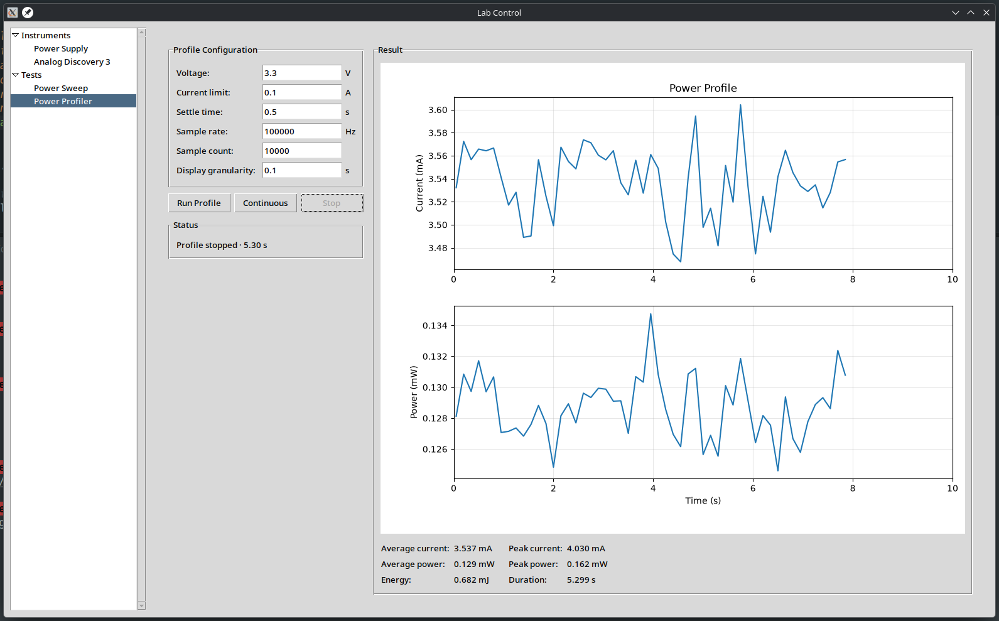

# AD3 Power Profiler
This repository contains the python program and any schematics needed to harnass the Analog Discovery 3's capabilities to create a power profiler. The current state of the program allows for short bursts as well as continuous runs (which dont run realtime yet) as well as power sweeps of a dedicated lab PSU. This is partially integrated into the profiling program.

## Future improvements
The plan is to allow for using both the internal as well as an external power supply when needed. Schematics for a fixture will be added to the repository as well. Additionally, the GPIO pins of AD3 will be used to mark sections in the power profilers graph in the future to sync it with code blocks. The continuous run should run real time and allow for some level of exporting data for analysis with 3rd party tools. 